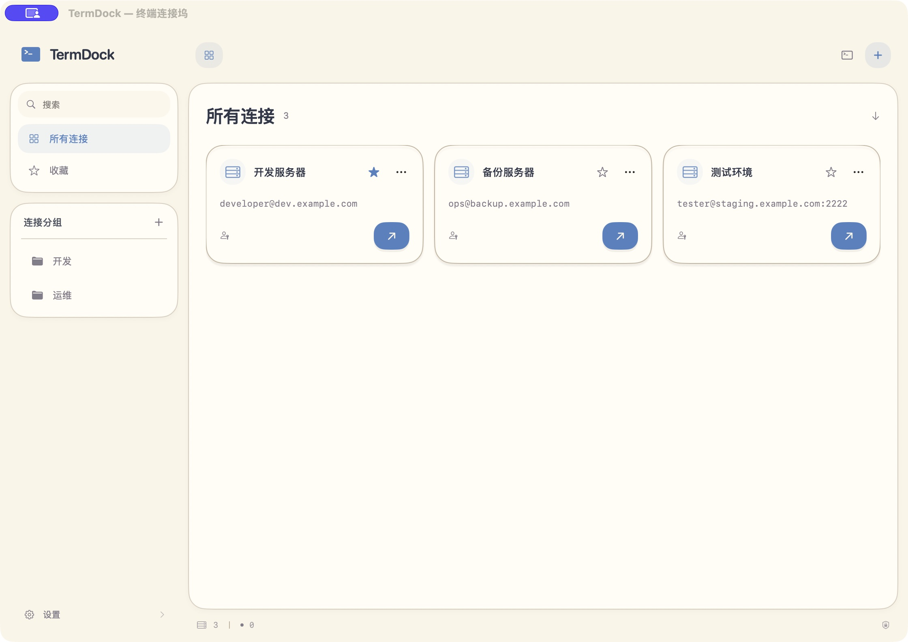
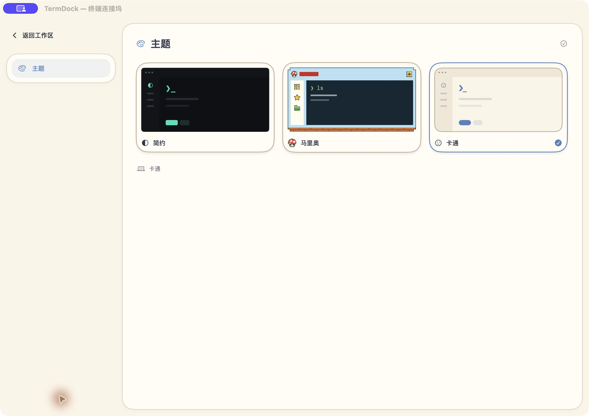

# TermDock

原生 macOS SSH 工作区，把常用服务器、终端会话和文件传输放在一个窗口里。

**[下载 TermDock v1.0.0](https://github.com/garycny/TermDock/releases/tag/v1.0.0)**  
适用于 Apple Silicon Mac，需 macOS 13 或更新版本。

- 管理 SSH 连接，支持分组、收藏、密码、私钥和 SSH Agent。
- 同时打开多个 SSH 或本地 Shell 会话，支持左右、上下分屏。
- 通过 SFTP 浏览、上传和下载文件。
- 本地命令提示提供中文说明和可填入的命令建议。
- 在主窗口内切换简约、马里奥与卡通主题。

## 安装

从 [v1.0.0 发布页](https://github.com/garycny/TermDock/releases/tag/v1.0.0) 下载 `TermDock-v1.0.0-macOS-arm64.zip`。解压后，将 `TermDock.app` 拖到「应用程序」。此版本使用临时签名，未经 Apple 公证。

## 截图

